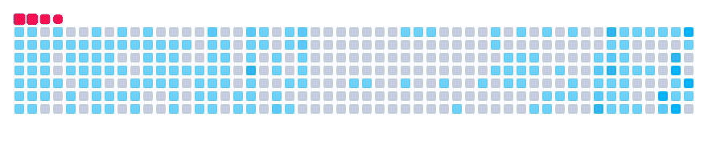

<!-- Don't tell anyone about this. -->

<picture>
  <source media="(prefers-color-scheme: dark)" srcset="https://raw.githubusercontent.com/gabrielogregorio/gabrielogregorio/main/assets/hero-dark.svg">
  <source media="(prefers-color-scheme: light)" srcset="https://raw.githubusercontent.com/gabrielogregorio/gabrielogregorio/main/assets/hero-light.svg">
  
</picture>

**Software engineer with 6 years of experience** 
<samp>Building secure and scalable web applications. Information security enthusiast.</samp>

## /ABOUT

<samp>Frontend developer with 5+ years in TypeScript, React and Next.js, in production with thousands of users.</samp> 
<samp>Focused on modular architecture, code quality, observability and security.</samp> 
<samp>Clean Architecture, TDD, Trunk-Based Development and accessibility.</samp> 
<samp>And I like building things.</samp>

🧑‍💻 **Programming more than** 

<picture>
  <source media="(prefers-color-scheme: dark)" srcset="https://raw.githubusercontent.com/gabrielogregorio/gabrielogregorio/output/github-snake-dark.svg">
  <source media="(prefers-color-scheme: light)" srcset="https://raw.githubusercontent.com/gabrielogregorio/gabrielogregorio/output/github-snake.svg">
  
</picture>

## /STACK

<table>
<tr>
<td><samp>./frontend</samp></td>
<td>

</td>
</tr>
<tr>
<td><samp>./mobile</samp></td>
<td>

</td>
</tr>
<tr>
<td><samp>./backend</samp></td>
<td>

</td>
</tr>
<tr>
<td><samp>./data</samp></td>
<td>

</td>
</tr>
<tr>
<td><samp>./ai</samp></td>
<td>

</td>
</tr>
<tr>
<td><samp>./infra</samp></td>
<td>

</td>
</tr>
<tr>
<td><samp>./tests</samp></td>
<td>

</td>
</tr>
</table>

## /SAFIRA

**A programming language in natural language for first-time programmers.** Write in Portuguese, English, Spanish, Chinese or Japanese, even mixing them, and run it in the browser with a debugger, lesson mode and per-project files.

**[🐈 See more of Safira: lessons, debugger, drawing, themes](https://github.com/gabrielogregorio/safira/wiki)**

## /PROJECTS

<table>
<tr>
<td width="50%" valign="top">

<h3><a href="https://github.com/gabrielogregorio/youtube-reload">🎵 YouTube Reload</a></h3>

Playlists of songs you have never heard.

</td>
<td width="50%" valign="top">

<h3><a href="https://github.com/gabrielogregorio/cine-lan">🎬 Cine LAN</a></h3>

My own media server: Python on a Raspberry Pi and a Fire TV app.

</td>
</tr>
<tr>
<td width="50%" valign="top">

</td>
<td width="50%" valign="top">

<h3><a href="https://github.com/gabrielogregorio/retrostick-os">🕹️ RetroStick OS</a></h3>

A custom system for the Game Stick 4K: menu, 8-bit music and save states. Runs from the SD card without touching the flash.

</td>
</tr>
<tr>
<td width="50%" valign="top">

<h3><a href="https://github.com/gabrielogregorio/tereza">🤖 Tereza</a></h3>

A Python chatbot on Telegram, with interactions based on extensions.

</td>
<td width="50%" valign="top">

<h3><a href="https://github.com/gabrielogregorio/tic-tac-toe-eletronic">🎮 Gamer Tic-Tac-Toe</a></h3>

Physical tic-tac-toe with LEDs, buttons and sound, built with Arduino and Python.

</td>
</tr>
<tr>
<td width="50%" valign="top">

</td>
<td width="50%" valign="top">

<h3><a href="https://github.com/gabrielogregorio/quick-note">📝 Quick Note</a></h3>

Chrome and Edge extension: jot down an idea instantly with <kbd>Alt</kbd> + <kbd>A</kbd>.

</td>
</tr>
</table>

## /DEVKIT

Tools I built for my daily work on Ubuntu.

<table>
<tr>
<td width="50%" valign="top">

<h3><a href="https://github.com/gabrielogregorio/devkit-lan-mouse-keyboard">🖱️ LAN Mouse & Keyboard</a></h3>

The phone becomes a mouse and keyboard, with shortcuts like <kbd>Ctrl</kbd> + <kbd>Alt</kbd> + <kbd>T</kbd>.

</td>
<td width="50%" valign="top">

<h3><a href="https://github.com/gabrielogregorio/devkit-lan-remote-desktop">🖥️ LAN Remote Desktop</a></h3>

Your screen in any browser on the network, with sound and an Xbox gamepad.

</td>
</tr>
<tr>
<td width="50%" valign="top">

<h3><a href="https://github.com/gabrielogregorio/devkit-lan-webcam">📷 LAN Webcam</a></h3>

Any camera on the network becomes a webcam on the PC.

</td>
<td width="50%" valign="top">

<h3><a href="https://github.com/gabrielogregorio/devkit-kube-deck">☸️ Kube Deck</a></h3>

A Kubernetes client that reads everything and deletes nothing.

</td>
</tr>
<tr>
<td width="50%" valign="top">

<h3><a href="https://github.com/gabrielogregorio/devkit-convert-wheel">🎯 Convert Wheel</a></h3>

The GTA weapon wheel turned into a file converter.

</td>
<td width="50%" valign="top">

<h3><a href="https://github.com/gabrielogregorio/devkit-lan-file-share">📲 LAN File Share</a></h3>

From Android to a folder on the PC, with QR code pairing.

</td>
</tr>
<tr>
<td colspan="2">

<h3><a href="https://github.com/gabrielogregorio/devkit-floating-monitor">📊 Floating Monitor</a></h3>

CPU, RAM and GPU on a line above every window.

</td>
</tr>
</table>

## /SECURITY

Real vulnerabilities found, with controlled POCs, responsible disclosure and help fixing them.

     

